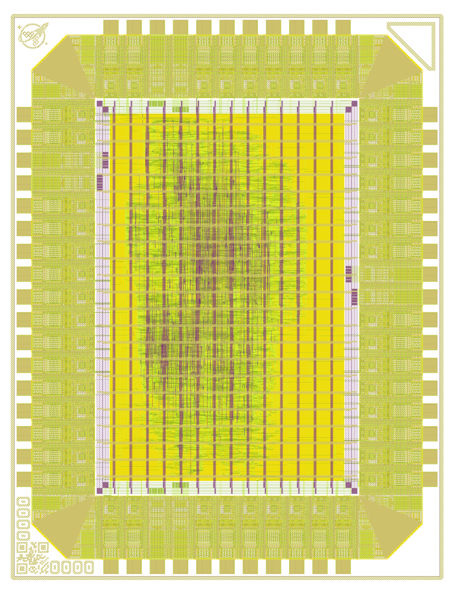

# A Z80 for wafer.space Run 3: RZ80 on GF180MCU, quarter slot

> **Branch `mcu9t5v0` is the 9-track comparison of `main`:** main's chip with the `gf180mcu_fd_sc_mcu9t5v0` cells; the results below are this branch's.

This is a Zilog Z80 for fabrication in GlobalFoundries' 180 nm process
(GF180MCU, 5 V) on [wafer.space](https://wafer.space)'s Run 3, in a quarter
slot (0.5 × 0.5: a 1.94 × 2.53 mm die, 48 signal pads and 8 power pads).

The CPU is **RZ80** ([rejunity/z80-from-schematics](https://github.com/rejunity/z80-from-schematics)):
the NMOS Z80 rebuilt from the schematics of the die, register for register
and half-cycle for half-cycle, and checked against perfectz80, the
transistor-level netlist of the Visual Z80 die scan, at every pin on every
half-cycle. It is the `rtl/` of that repository, copied unchanged into
`src/rz80/` from the `rz80/` submodule. The chip around it, its pads and
its pad mapping come from
[ws0-z80-open-silicon-gf180mcu](https://github.com/rejunity/ws0-z80-open-silicon-gf180mcu)'s
quarter slot; the project is built on wafer.space's
[gf180mcu project template](https://github.com/wafer-space/gf180mcu-project-template).

## The chip

| | |
|---|---|
| CPU | RZ80, `src/rz80/` = RZ80 `rtl/` at [`f88c75e`](https://github.com/rejunity/z80-from-schematics/commit/f88c75e098c00ae95572647130dbad023463088c) (CERN-OHL-W-2.0) |
| Process | GF180MCU (`gf180mcuD`), 5 V, 5 metal layers |
| Cells | `gf180mcu_fd_sc_mcu9t5v0`, the 9-track 5 V library (main: `gf180mcu_fd_sc_mcu7t5v0`, 7-track) |
| Slot | `0p5x0p5`: die 1936 × 2531 µm, core 1052 × 1647 µm |
| Bus pads | `gf180mcu_fd_io__bi_t` at 4 mA with slow slew on all 32 bus pins: the library's weakest drive, near the NMOS Z80's (it sinks 2 mA at 0.4 V) |
| Input pads | `in_s` (Schmitt trigger) for CLK and RESET, as on RZ80's own GF180 chip; `in_c` (CMOS) for WAIT, INT, NMI, BUSRQ; the 10 unused inputs pulled down |
| Clock | one clock, at the CLK pin; the core laid out for 50 ns (20 MHz) at every corner, the pins held to the NMOS Z80's datasheet at 4, 6 and 8 MHz |
| Power-on | as on the Z80, none: hold RESET low for 3 clocks or more after power-up |

### Pins and pads

Pads are numbered counter-clockwise from the bottom left of the layout
(`librelane/slots/slot_0p5x0p5.yaml`, which also draws them).

| Pad | Pin | Pad | Pin | Pad | Pin | Pad | Pin |
|---|---|---|---|---|---|---|---|
| 0 | M1 | 14 | A8 | 28 | CLK | 42 | VSS |
| 1 | RFSH | 15 | A9 | 29 | - | 43 | INT |
| 2 | DVSS | 16 | A10 | 30 | - | 44 | NMI |
| 3 | DVDD | 17 | A11 | 31 | D4 | 45 | HALT |
| 4 | - | 18 | - | 32 | D3 | 46 | MREQ |
| 5 | - | 19 | DVSS | 33 | D5 | 47 | IORQ |
| 6 | A0 | 20 | DVDD | 34 | D6 | 48 | RD |
| 7 | A1 | 21 | - | 35 | DVDD | 49 | WR |
| 8 | A2 | 22 | A12 | 36 | DVSS | 50 | BUSAK |
| 9 | A3 | 23 | A13 | 37 | D2 | 51 | WAIT |
| 10 | A4 | 24 | A14 | 38 | D7 | 52 | - |
| 11 | A5 | 25 | A15 | 39 | D0 | 53 | - |
| 12 | A6 | 26 | - | 40 | D1 | 54 | BUSRQ |
| 13 | A7 | 27 | - | 41 | VDD | 55 | RESET |

RESET (pad 55) is on a Schmitt-trigger pad, `in_s`, like CLK (pad 28), as on
RZ80's own GF180 chip: a RESET from an RC network ramps slowly, and the
hysteresis switches it once. The template, and ws0, have a CMOS `in_c` there;
the two cells share their footprint and pins, so the pad keeps its place.

`DVDD`/`DVSS` are the I/O supply and `VDD`/`VSS` the core's: the
`gf180mcu_fd_io` library shorts the two domains, so the chip runs from one
5 V supply, like the Z80.

## Results

A local run of `make librelane` on 2026-10-26 at `b7de5f8` (CI repeats the
flow on every push and prints its sign-off in the run's summary):

| | |
|---|---|
| Logic | 11,120 cells, 300k µm² (17 % of the core), 479 flip-flops |
| Setup slack, 50 ns | typical +10.57 ns · slow +2.65 ns (max wires +1.91) · fast +13.91 ns |
| Hold slack | +0.25 ns or more at every corner |
| Fastest clock | typical 35 MHz · slow 22 MHz (max wires 22 MHz) · fast 45 MHz |
| Sign-off | route DRC 0, Magic DRC 0, KLayout DRC 0, LVS 0, antenna 0, XOR 0; setup and hold at all 9 corners |
| NMOS Z80 pin timing | PASS at 4, 6 and 8 MHz at the typical, slow and fast corners: all 47 parameters at each grade's own clock (`make pin-timing`) |

The flow signs off setup and hold at every corner: typical, slow (125 °C,
4.5 V) and fast (−40 °C, 5.5 V), each with nominal, minimum and maximum
wires. The core's limit is its half-cycle paths (launched on one clock edge,
caught on the other): the clock starts at the CLK pin, and the Schmitt-trigger
CLK pad delays its fall about 3 ns more than its rise, which comes out of
every such half-cycle, as it would on the chip.

### Timing constraints

The flow is constrained by the NMOS Z80's datasheet, as RZ80's own chip
flows are: `timing/chip_top_nmos.sdc`, generated from the Z8400's AC
characteristics (Zilog PS0178, `timing/z8400_nmos.json`) by
`timing/pin_timing.py --write-sdc` (`make sdc`; CI checks it is up to date),
is the flow's one SDC, for placement, routing and sign-off:

- one clock, CLK, at the CLK pin, 50 ns: the CLK pad and the clock tree are in
  every path, the pins' as in the datasheet's measurements, and CTS builds
  the tree from the pad's output;
- every pin parameter that is a delay from a CLK edge -- the outputs'
  delays, float delays, the inputs' setup and hold -- at the strictest of the
  4, 6 and 8 MHz grades, in ns from the CLK pin's edge, each at its own grade's
  test conditions: edges (15, 16, 7.5 ns), inputs valid at 2.0 / 0.8 V,
  outputs at 1.5 V into 100 pF, the pads as RZ80 simulated them at transistor
  level (`spice/pads/`), the corner that asks most. An output launched on one
  CLK edge is held only to the parameter from that edge, an input only to the
  setup and hold around the edge that samples it;
- the flow's resizer repairs them at every corner: it adds the hold delay
  the WAIT, INT, BUSRQ and RESET inputs need, as RZ80's chip flow does;
- the special cases that hold on this chip: NMI is asynchronous (z80_top's
  pulse catcher); MREQ, IORQ, RD and WR float only in a bus grant and come
  back high, so their pads never turn on driving low; read data is held until
  RD (IORQ in an interrupt acknowledge) rises, which `pin_timing.py` checks
  against the chip's own RD; the data pads' input enables are no path. (RZ80's
  z80_chip floats the address bus from RESET directly; here the address pads
  follow z80_top's registered drive, so that case does not exist.)

The parameters that depend on the clock period -- pulse widths and the
separations between pins -- are `pin_timing.py`'s, which measures every
parameter with OpenSTA at each grade's own clock, every corner (`make
pin-timing`, every push).

The pins, into 100 pF with the pads as RZ80 simulated them: every output
1.0-44.0 ns after its CLK edge (the limits are 55-300 ns); the opcode's setup
TsD(Cr) needs 18.6 ns at the slow corner (30-35 allowed). The tightest
margins are the input holds at the fast corner, WAIT's 1.5 ns (6 MHz) and
1.8 ns (4 MHz), and at 8 MHz the I/O write's data-to-WR separation, 1.5 ns.

Against main's 7-track layout (the run at `f873608`: the same constraints
and flow): 15 % more logic area, 300k µm² against 260k, in fewer cells
(11,120 against 11,895; 3,402 repair buffers against 3,724), and the same
speed within a few percent: both are held by the same kind of half-cycle
path, typical 34.7 MHz against 35.3, slow 22.4 against 22.3 (max wires 21.7
against 21.1), fast 45.1 against 46.2. The 9-track cells leave the
whole-cycle paths 16 ns more slack at the slow corner (+25.0 ns against
+8.8), and the post-CTS repair resized 7 cells against 240. The tightest
pin margins are within 0.1 ns of the 7-track chip's at every grade, and the
outputs' delays have 1.4-2.8 ns more. Hold is +0.25 ns at worst against
+0.67, at the WR output at the fast corner. The core's power, vectorless at
the typical corner: 135 mW against 113.

Against ws0's quarter slot with RZ80 (9-track cells too, `bi_24t` pads at
their full drive, 40 ns and the template's constraints): 9 % more logic
area, 300k µm² against 276k, mostly repair buffers (3,402 against 2,057).

## Tests

[tests/README.md](tests/README.md) lists every test, what its expectations
come from (the die through perfectz80, or real Z80s) and where it runs:

- **cocotb on the RTL and on the gate-level netlist, through the pads:**
  ws0's 14 pin-level tests, RZ80's signs of life, HALT to INT acknowledge
  against the die, every instruction of a real Z80's logic-analyser
  capture (a KC 85/4's U880), and Cringle's prelim;
- **iverilog, against perfectz80's recorded traces, half-cycle by
  half-cycle:** the 14 trace programs and the 15 pin scenarios, on the RTL
  and on the chip's netlist through its pads; the pin sweep, every opcode
  and pin event (51,126 cases; RESET at every half-cycle of every opcode
  nightly);
- **iverilog on the RTL:** FUSE's tests with the die's values, the X / Y
  flag corpus, RZ80's bus-control testbenches;
- **Verilator on the RTL:** ZEXDOC and ZEXALL in full, Patrik Rak's
  z80test, NASCOM BASIC and Tiny BASIC;
- **the layout:** LibreLane's sign-off at every corner, wafer.space's
  precheck, and OpenSTA against the Z8400's AC characteristics at 4, 6 and
  8 MHz at every corner;
- **the pad ring:** every power and ground pad, in every slot, as in the
  wafer.space template (`make check-power-pads`).

Nothing may fail. CI (`.github/workflows/ci.yml`) runs all of it on every
push, ZEXDOC and ZEXALL in full on main and nightly.

## Transistor level

The whole chip, extracted from its GDS, runs a short program in ngspice at the typical, slow and fast corners: [spice/README.md](spice/README.md). The workflow is `.github/workflows/transistor.yml`, on demand; its figures go in `spice/chip/gf180mcu/`.

## Build and test

The template's Nix shell has every tool:
[install Nix and LibreLane](https://librelane.readthedocs.io/en/latest/installation/nix_installation/index.html),
check out with the submodule, and run `nix-shell` here.

    git clone --recursive https://github.com/rejunity/ws3-z80-open-silicon-gf180mcu
    make clone-pdk           # the gf180mcuD PDK, through ciel
    make sim                 # cocotb on the RTL (the chip's pads)
    make sim-system          # whole programs on the RTL
    make librelane           # RTL to GDS (final/ holds the views)
    make sim-gl sim-system-gl   # the same on the gate-level netlist
    make pin-timing          # the pins against the NMOS datasheet, 4/6/8 MHz, every corner
    make sdc                 # the flow's SDC, from timing/ (make sdc-check: up to date)
    make precheck            # wafer.space's precheck of final/gds/chip_top.gds
    make rz80-elab rz80-bus rz80-fuse rz80-xyflags rz80-traces rz80-sweep   # iverilog
    make rz80-traces-gl      # the trace programs on the gate-level netlist
    make rz80-z80test Z80TEST=z80full   rz80-basic   rz80-zex ZEX=zexdoc   # Verilator

`make librelane-openroad` and `make librelane-klayout` open the last run;
`make help` lists every target.

### Updating RZ80

`rz80/` pins RZ80's commit; `scripts/sync_rz80.py` copies what the chip and
its tests use (the RTL, test harnesses, timing data) into `src/rz80/`,
`tests/rz80/`, `timing/` and `spice/`, applying the few patches it lists,
and `--check` (CI) fails when a copy is out of step:

    git -C rz80 fetch && git -C rz80 checkout <commit>
    scripts/sync_rz80.py
    make sdc                 # timing/ may have changed
    git add rz80 src/rz80 tests/rz80 timing spice && git commit

## Licensing

Component licensing ([LICENSE](LICENSE)): the chip, its configuration and
tooling are Apache-2.0, as the template; RZ80 in `src/rz80/` is
CERN-OHL-W-2.0, and a product made from this chip must display RZ80's
Source Location ([HARDWARE_NOTICE.md](HARDWARE_NOTICE.md)); the copies of
RZ80's test harnesses are MIT. Third-party test programs stay in the
`rz80/` submodule under their own licenses.

