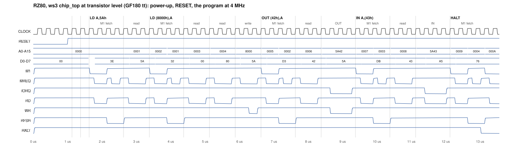
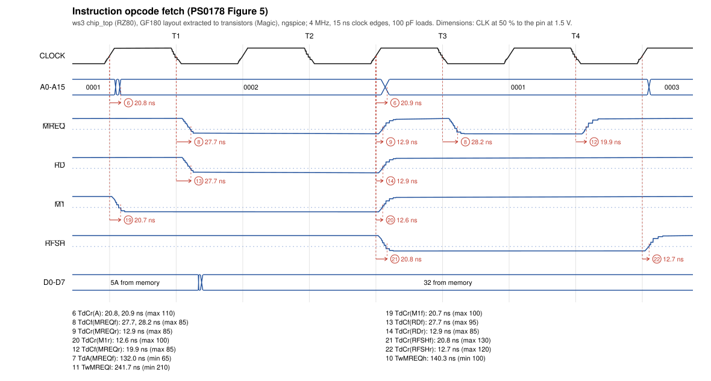
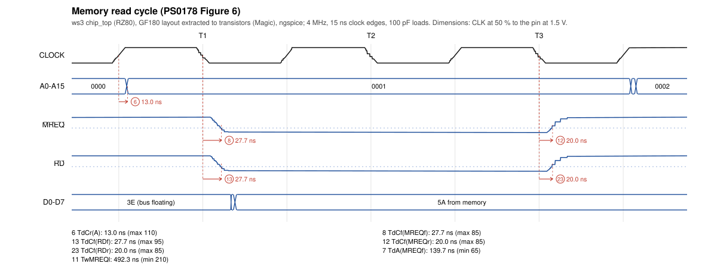
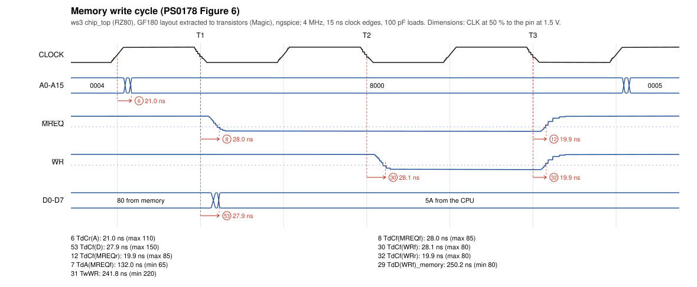
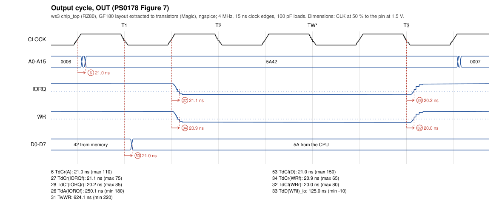
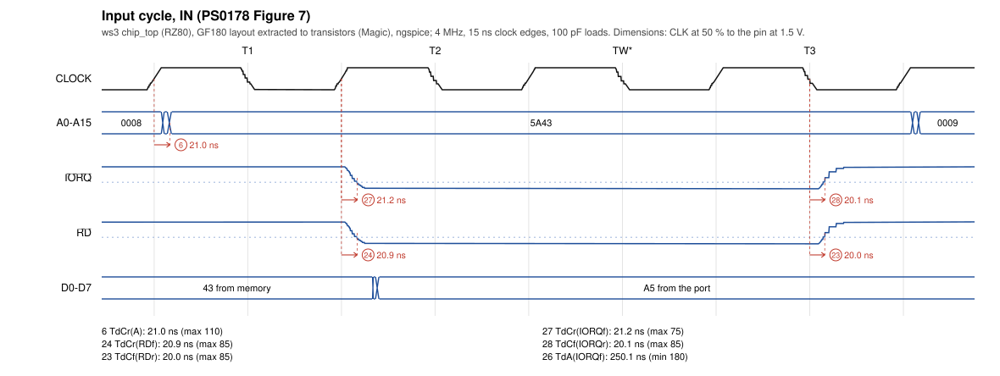

# The chip at transistor level

The whole chip, extracted from its GDS to transistors with Magic, runs a short program in ngspice: power-up, 4 clocks of RESET, then `LD A,5Ah / LD (8000h),A / OUT (42h),A / IN A,(43h) / HALT` at 4 MHz, 15 ns clock edges, 100 pF on every pin ([spice/README.md](../../spice/README.md)). The pins are checked against the RTL on every clock edge, and every output parameter of the Z8400's datasheet (Zilog PS0178) on every cycle that has it.

- workflow run: [40376451729](https://github.com/rejunity/ws3-z80-open-silicon-gf180mcu/actions/runs/40376451729) (*Transistor*, `.github/workflows/transistor.yml`)
- the chip: commit [`c3feb60`](https://github.com/rejunity/ws3-z80-open-silicon-gf180mcu/commit/c3feb6054c43ecac5b5f8c0f3c8ed379a1581659), GDS from CI run [40333439841](https://github.com/rejunity/ws3-z80-open-silicon-gf180mcu/actions/runs/40333439841)
- verdict: **PASS**

This folder is written by the workflow's `publish` job (`scripts/transistor_docs.py`); do not edit it by hand.

## Corners

| corner | | pins vs RTL | datasheet parameters |
|---|---|---|---|
| [`tt`](results.json) | typical, 25 °C, 5.0 V | every edge matches | 25 / 25 pass |
| [`ss`](ss/results.json) | slow, 125 °C, 4.5 V | every edge matches | 25 / 25 pass |
| [`ff`](ff/results.json) | fast, -40 °C, 5.5 V | every edge matches | 25 / 25 pass |

## Datasheet parameters

Measured on every cycle that has the parameter: the extremes over the run, in ns (outputs where they cross 1.5 V, CLK at 50 %).

| # | parameter | limit | tt min / max | ss min / max | ff min / max | |
|---|---|---|---|---|---|---|
| 6 | `TdCr(A)` | ≤ 110 | 13.0 / 21.2 | 25.2 / 36.8 | 7.1 / 13.3 | pass |
| 7 | `TdA(MREQf)` | ≥ 65 | 131.5 / 140.0 | 130.6 / 142.6 | 132.6 / 139.0 | pass |
| 8 | `TdCf(MREQf)` | ≤ 85 | 27.7 / 28.2 | 42.3 / 43.1 | 20.9 / 21.2 | pass |
| 9 | `TdCr(MREQr)` | ≤ 85 | 12.9 / 13.0 | 25.0 / 25.2 | 7.0 / 7.1 | pass |
| 10 | `TwMREQh` | ≥ 100 | 139.8 / 140.3 | 142.3 / 143.1 | 138.8 / 139.2 | pass |
| 11 | `TwMREQl` | ≥ 210 | 241.7 / 492.3 | 238.3 / 489.3 | 243.6 / 493.9 | pass |
| 12 | `TdCf(MREQr)` | ≤ 85 | 19.9 / 20.0 | 31.3 / 31.6 | 14.8 / 14.8 | pass |
| 13 | `TdCf(RDf)` | ≤ 95 | 27.7 / 28.1 | 42.3 / 42.9 | 20.9 / 21.1 | pass |
| 14 | `TdCr(RDr)` | ≤ 85 | 12.9 / 13.0 | 25.0 / 25.2 | 7.0 / 7.1 | pass |
| 19 | `TdCr(M1f)` | ≤ 100 | 20.6 / 20.7 | 35.8 / 35.9 | 13.0 / 13.0 | pass |
| 20 | `TdCr(M1r)` | ≤ 100 | 12.6 / 12.6 | 24.5 / 24.5 | 6.8 / 6.8 | pass |
| 21 | `TdCr(RFSHf)` | ≤ 130 | 20.7 / 20.8 | 35.9 / 36.0 | 13.0 / 13.1 | pass |
| 22 | `TdCr(RFSHr)` | ≤ 120 | 12.7 / 12.7 | 24.6 / 24.7 | 6.9 / 6.9 | pass |
| 23 | `TdCf(RDr)` | ≤ 85 | 19.9 / 20.0 | 31.4 / 31.6 | 14.8 / 14.8 | pass |
| 24 | `TdCr(RDf)` | ≤ 85 | 20.9 / 20.9 | 36.3 / 36.3 | 13.2 / 13.2 | pass |
| 26 | `TdA(IORQf)` | ≥ 180 | 250.1 / 250.1 | 250.2 / 250.3 | 250.1 / 250.1 | pass |
| 27 | `TdCr(IORQf)` | ≤ 75 | 21.1 / 21.2 | 36.7 / 36.8 | 13.3 / 13.4 | pass |
| 28 | `TdCf(IORQr)` | ≤ 85 | 20.1 / 20.2 | 31.7 / 31.9 | 14.9 / 14.9 | pass |
| 29 | `TdD(WRf)_memory` | ≥ 80 | 250.2 / 250.2 | 250.3 / 250.3 | 250.2 / 250.2 | pass |
| 30 | `TdCf(WRf)` | ≤ 80 | 28.1 / 28.1 | 43.1 / 43.1 | 21.1 / 21.1 | pass |
| 31 | `TwWR` | ≥ 220 | 241.8 / 624.1 | 238.3 / 620.2 | 243.7 / 626.6 | pass |
| 32 | `TdCf(WRr)` | ≤ 80 | 19.9 / 20.0 | 31.4 / 31.6 | 14.8 / 14.9 | pass |
| 33 | `TdD(WRf)_io` | ≥ -10 | 125.0 / 125.0 | 128.3 / 128.3 | 122.8 / 122.8 | pass |
| 34 | `TdCr(WRf)` | ≤ 65 | 20.9 / 20.9 | 36.4 / 36.4 | 13.2 / 13.2 | pass |
| 53 | `TdCf(D)` | ≤ 150 | 21.0 / 27.9 | 33.2 / 42.8 | 15.5 / 21.0 | pass |

## Figures (typical corner)

The slow and fast corners' are in [ss/](ss/) and [ff/](ff/).

<picture>
  <source media="(prefers-color-scheme: dark)" srcset="program-dark.svg">
  
</picture>

opcode fetch (PS0178 Figure 5):

memory read (Figure 6):

memory write (Figure 6):

I/O write (Figure 7):

I/O read (Figure 7):

