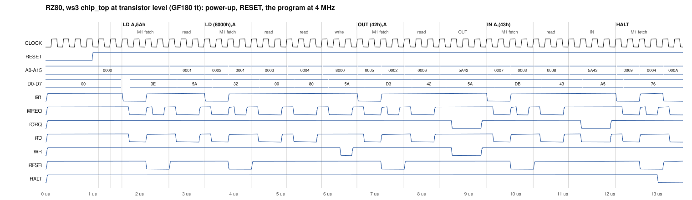
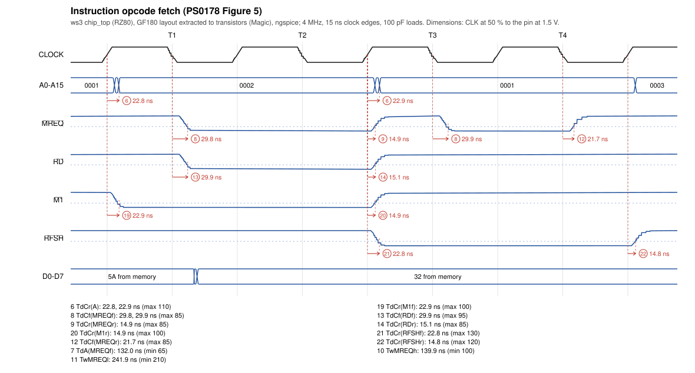
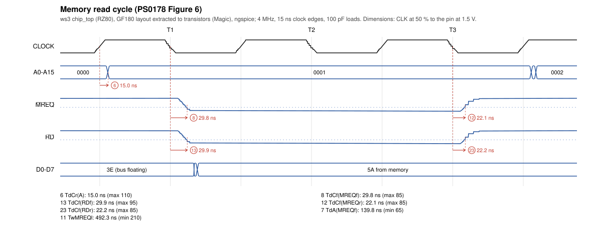
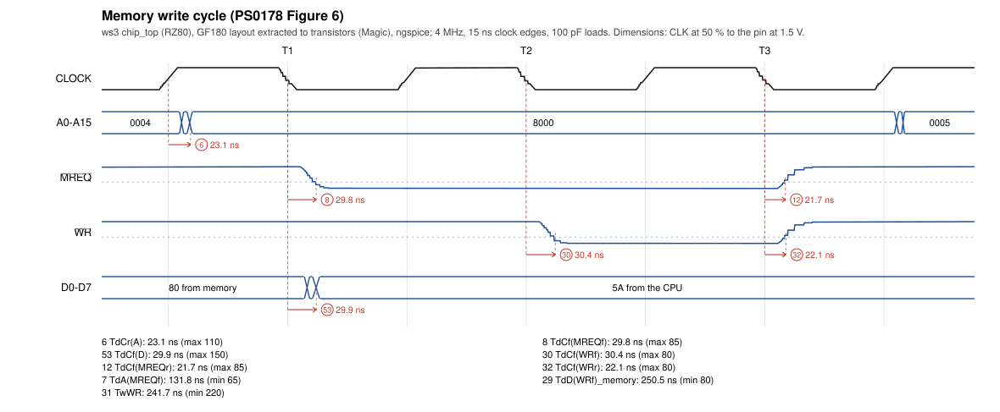
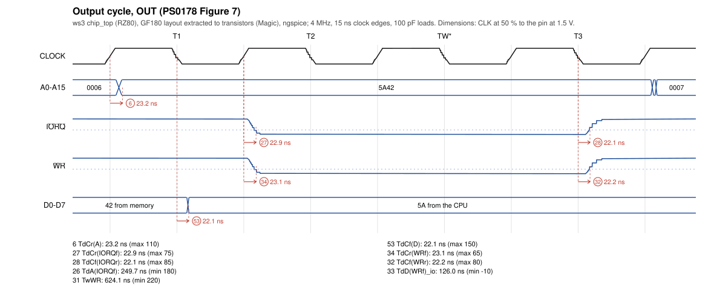
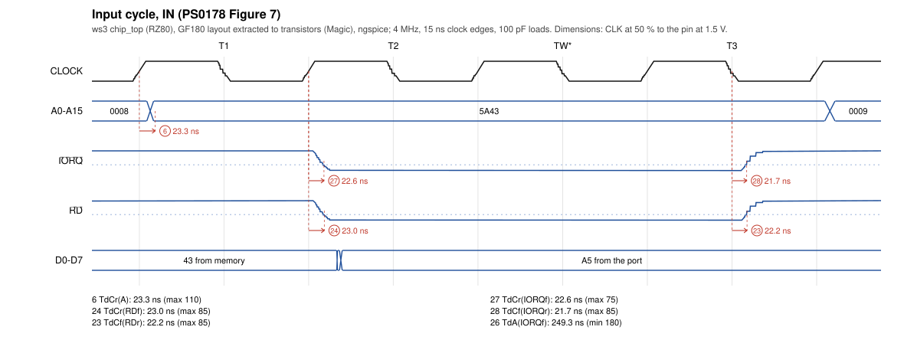

# The chip at transistor level

The whole chip, extracted from its GDS to transistors with Magic, runs a short program in ngspice: power-up, 4 clocks of RESET, then `LD A,5Ah / LD (8000h),A / OUT (42h),A / IN A,(43h) / HALT` at 4 MHz, 15 ns clock edges, 100 pF on every pin ([spice/README.md](../../spice/README.md)). The pins are checked against the RTL on every clock edge, and every output parameter of the Z8400's datasheet (Zilog PS0178) on every cycle that has it.

- workflow run: [40986098763](https://github.com/rejunity/ws3-z80-open-silicon-gf180mcu/actions/runs/40986098763) (*Transistor*, `.github/workflows/transistor.yml`)
- the chip: commit [`500d70d`](https://github.com/rejunity/ws3-z80-open-silicon-gf180mcu/commit/500d70d45aadc64f76afb135d4add211ab4d3617), GDS from CI run [40954450730](https://github.com/rejunity/ws3-z80-open-silicon-gf180mcu/actions/runs/40954450730)
- verdict: **PASS**

This folder is written by the workflow's `publish` job (`scripts/transistor_docs.py`); do not edit it by hand.

## Corners

| corner | | pins vs RTL | datasheet parameters |
|---|---|---|---|
| [`tt`](results.json) | typical, 25 °C, 5.0 V | every edge matches | 25 / 25 pass |
| [`ss`](ss/results.json) | slow, 125 °C, 4.5 V | every edge matches | 25 / 25 pass |
| [`ff`](ff/results.json) | fast, -40 °C, 5.5 V | every edge matches | 25 / 25 pass |

## Datasheet parameters

Measured on every cycle that has the parameter: the extremes over the run, in ns (outputs where they cross 1.5 V, CLK at 50 %).

| # | parameter | limit | tt min / max | ss min / max | ff min / max | |
|---|---|---|---|---|---|---|
| 6 | `TdCr(A)` | ≤ 110 | 15.0 / 23.3 | 28.6 / 40.3 | 8.4 / 14.8 | pass |
| 7 | `TdA(MREQf)` | ≥ 65 | 131.4 / 139.8 | 130.5 / 142.3 | 132.4 / 138.9 | pass |
| 8 | `TdCf(MREQf)` | ≤ 85 | 29.8 / 29.9 | 45.9 / 46.1 | 22.2 / 22.3 | pass |
| 9 | `TdCr(MREQr)` | ≤ 85 | 14.9 / 14.9 | 28.4 / 28.5 | 8.3 / 8.3 | pass |
| 10 | `TwMREQh` | ≥ 100 | 139.9 / 140.0 | 142.6 / 142.7 | 139.0 / 139.0 | pass |
| 11 | `TwMREQl` | ≥ 210 | 241.9 / 492.3 | 238.4 / 489.4 | 243.7 / 494.0 | pass |
| 12 | `TdCf(MREQr)` | ≤ 85 | 21.7 / 22.2 | 34.5 / 35.3 | 16.0 / 16.3 | pass |
| 13 | `TdCf(RDf)` | ≤ 95 | 29.9 / 30.2 | 46.0 / 46.6 | 22.3 / 22.5 | pass |
| 14 | `TdCr(RDr)` | ≤ 85 | 15.1 / 15.2 | 28.7 / 28.9 | 8.4 / 8.5 | pass |
| 19 | `TdCr(M1f)` | ≤ 100 | 22.9 / 23.0 | 39.7 / 39.8 | 14.5 / 14.6 | pass |
| 20 | `TdCr(M1r)` | ≤ 100 | 14.9 / 14.9 | 28.5 / 28.5 | 8.3 / 8.3 | pass |
| 21 | `TdCr(RFSHf)` | ≤ 130 | 22.8 / 22.8 | 39.5 / 39.6 | 14.4 / 14.5 | pass |
| 22 | `TdCr(RFSHr)` | ≤ 120 | 14.8 / 14.8 | 28.2 / 28.2 | 8.2 / 8.2 | pass |
| 23 | `TdCf(RDr)` | ≤ 85 | 22.1 / 22.2 | 35.1 / 35.3 | 16.2 / 16.3 | pass |
| 24 | `TdCr(RDf)` | ≤ 85 | 23.0 / 23.0 | 40.1 / 40.1 | 14.7 / 14.7 | pass |
| 26 | `TdA(IORQf)` | ≥ 180 | 249.3 / 249.7 | 249.0 / 249.7 | 249.7 / 249.9 | pass |
| 27 | `TdCr(IORQf)` | ≤ 75 | 22.6 / 22.9 | 39.3 / 39.8 | 14.4 / 14.5 | pass |
| 28 | `TdCf(IORQr)` | ≤ 85 | 21.7 / 22.1 | 34.4 / 35.2 | 15.9 / 16.2 | pass |
| 29 | `TdD(WRf)_memory` | ≥ 80 | 250.5 / 250.5 | 250.7 / 250.7 | 250.3 / 250.3 | pass |
| 30 | `TdCf(WRf)` | ≤ 80 | 30.4 / 30.4 | 46.9 / 46.9 | 22.6 / 22.6 | pass |
| 31 | `TwWR` | ≥ 220 | 241.7 / 624.1 | 238.3 / 620.3 | 243.6 / 626.6 | pass |
| 32 | `TdCf(WRr)` | ≤ 80 | 22.1 / 22.2 | 35.2 / 35.4 | 16.3 / 16.3 | pass |
| 33 | `TdD(WRf)_io` | ≥ -10 | 126.0 / 126.0 | 130.0 / 130.0 | 123.4 / 123.4 | pass |
| 34 | `TdCr(WRf)` | ≤ 65 | 23.1 / 23.1 | 40.1 / 40.1 | 14.7 / 14.7 | pass |
| 53 | `TdCf(D)` | ≤ 150 | 22.1 / 29.9 | 35.2 / 46.3 | 16.2 / 22.3 | pass |

## Figures (typical corner)

The slow and fast corners' are in [ss/](ss/) and [ff/](ff/).

<picture>
  <source media="(prefers-color-scheme: dark)" srcset="program-dark.svg">
  
</picture>

opcode fetch (PS0178 Figure 5):

memory read (Figure 6):

memory write (Figure 6):

I/O write (Figure 7):

I/O read (Figure 7):

